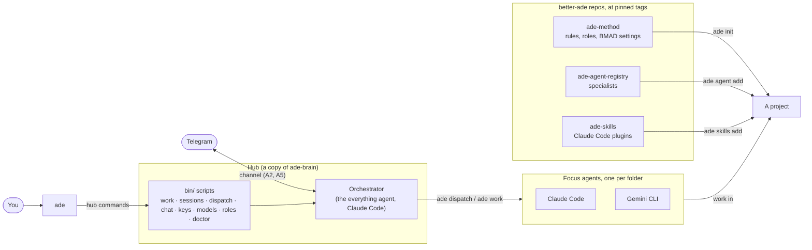
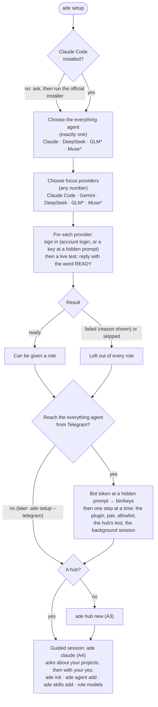
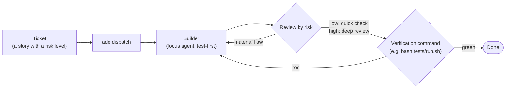

<p align="center">
  
</p>

<h1 align="center">ade</h1>

<p align="center"><strong>One command for ADE in any terminal: your hub, your agents, your method.</strong></p>

<p align="center">
  <a href="https://github.com/better-ade/ade-cli/actions/workflows/ci.yml"></a>
  <a href="https://github.com/better-ade/ade-cli/releases/latest"></a>
  <a href="https://github.com/better-ade/ade-cli"></a>
  
</p>

<p align="center">
  <a href="https://github.com/better-ade/ade-terminal"><strong>ADE app</strong></a> ·
  <a href="https://github.com/better-ade/ade-brain"><strong>ade-brain</strong></a> ·
  <a href="https://github.com/better-ade/ade-method"><strong>ade-method</strong></a> ·
  <a href="https://github.com/better-ade/ade-agent-registry"><strong>ade-agent-registry</strong></a> ·
  <a href="https://github.com/better-ade/ade-skills"><strong>ade-skills</strong></a>
</p>

<p align="center">
  
</p>
<p align="center"><sub>A sketch of <code>ade ui</code> (<a href="docs/stories/A6-ade-ui-tabs.md">A6</a>). Today's commands are in the <a href="#command-reference">command reference</a>.</sub></p>

## What it is

`ade` is a small Bash command that brings ADE to any terminal on macOS or Linux, with or without the ADE desktop app.
Inside a hub (a copy of [ade-brain](https://github.com/better-ade/ade-brain)) it runs the hub's own `bin/` scripts, so
the hub stays the single source of truth and `ade` stays thin. Inside a project it sets up the ADE method, specialist
agents and skills from their own repos, at pinned versions, and never overwrites a file you already have.

> **Status:** version `0.2.12`. Built: the hub and project commands (A1), orchestrators (A2), `hub new` (A3),
> `ade claude` (A4), `ade setup` (A5), `ade ui` (A6), skills (A7), `clean`, `reset` and `uninstall` (A9), `restore`
> (A10), `update` and update notices (A11, A12), the file viewer (A15), the guided first run (A18), `ade web` (A19),
> `ade shot` (A20), `ade project` (A21), `ade connect` (A16), a raw Ubuntu install (A22), the tools step (A23), `ade hub import` (I3), `ade shot`
> on Ubuntu 23.10+ and macOS CI (A24, A25) and `ade keys` setting missing keys (A26). Not
> built yet: keys and the clipboard ([A13](docs/stories/A13-keys-and-clipboard.md)), the vault ([A14](docs/stories/A14-ade-vault.md)) and the
> connect checks ([A17](docs/stories/A17-connect-check-doctor-restore.md)).

## Install

**Today** (needs `git` and Bash; `python3` for `ade agent`; Claude Code for `ade skills add`):

```bash
git clone https://github.com/better-ade/ade-cli && cd ade-cli && ./install.sh
```

`install.sh` writes `~/.local/bin/ade` with the version stamped in, and tells you when that folder is not on your
`PATH`. Pass a prefix to install somewhere else: `./install.sh /usr/local`. Re-run it after a `git pull` to upgrade.

Or in one line ([A3](docs/stories/A3-hub-new-and-first-run.md)): the tagged release that main's `VERSION` names, never
main itself (`ADE_CLI_REF=v0.1.0` picks another release by its tag).

```bash
curl -fsSL https://raw.githubusercontent.com/better-ade/ade-cli/main/install.sh | bash
```

**On Ubuntu** (server or desktop, 24.04; [A22](docs/stories/A22-raw-ubuntu.md)): a fresh Ubuntu Server has no `curl`,
`git` or `python3`, and Ubuntu Desktop has no `curl` or `git`. Install them first, or let the installer offer it:

```bash
sudo apt-get update && sudo apt-get install -y curl git python3
```

Ubuntu Desktop ships `wget`, so its one line can also be this (the installer then downloads with `wget`):

```bash
wget -qO- https://raw.githubusercontent.com/better-ade/ade-cli/main/install.sh | bash
```

The installer names anything it still lacks in one line and, after your yes at the terminal, installs it with
`sudo apt-get update && sudo apt-get install -y`. `ade setup` does the same for the rest (`tmux`, `gh`, `gitleaks`),
downloads `bun` itself, and asks for your git name and email when git has none yet.

## Quick start

```bash
ade help                         # every command, one line each
ade version                      # ade 0.2.12

# In a project (any git repo); no hub needed
ade init                         # copy ade-method at its pinned tag; lists what it kept
ade agent list                   # specialists in ade-agent-registry
ade agent add frontend           # copy one into .ade/agents/frontend.md
ade skills add git               # install an ade-skills plugin for this project (needs Claude Code)
ade skills add notes             # meeting notes, summaries and action items into a folder

# With a hub
mkdir -p ~/.config/ade && echo ~/hubs/my-hub > ~/.config/ade/hub   # or export ADE_HUB, or run ade inside the hub
ade doctor                       # the hub's bin/doctor
ade status                       # the hub's sessions (bin/sessions)
ade work projects/api --role builder   # start or resume a focus agent (bin/work)
ade keys                         # your AI tool keys, the one place: the list, then (at a terminal) set the missing ones
ade keys share alice glm         # share, receive and set go to the hub's bin/keys as typed

# Load repos you already have into the hub (A21)
ade project add ~/Project/api ~/Project/web    # each becomes projects/<name>, with its ACCESS.md Code row
ade project add acme/billing                   # a URL or owner/repo is cloned into your code folder first
ade project add --scan ~/Project               # pick from the repos in a folder: 1 3 4, 1-3, all, or names
ade project list                               # name, checkout, branch, focus agent, last update
```

`ade` with no hub lists the steps to a working hub and offers to start the guide; `ade setup` is the guide, one step
at a time, and run again it picks up where you are ([A18](docs/stories/A18-guided-first-run.md)). GitHub is
required: the guide installs `gh` (after a yes) and runs GitHub's own browser sign-in. `ade hub new my-hub` creates
the hub ([A3](docs/stories/A3-hub-new-and-first-run.md)); providers, Telegram and the guided first session are
[A5](docs/stories/A5-ade-setup.md).

## How ade fits



`ade` itself holds no state about your work. It finds the hub in this order: `$ADE_HUB`, the nearest folder above the
current one with `bin/lib.sh` and `hub.conf`, then the path in `~/.config/ade/hub`. When the hub lacks a script, `ade`
says "this hub has no bin/&lt;cmd&gt;; update it" and exits 2.

## `ade setup` (A5)

One command from nothing to a working hub and a guided first session. Every step asks first. Since A18 the steps
are listed with their state and run in this order: Claude Code, sign in to Claude, sign in to GitHub, your hub (with
the providers below), your first project (the guided session), then Telegram (optional); a step already done is
skipped. The chart shows the provider and Telegram steps. `ade setup` with no flags refuses inside an agent
session (a person answers it); `--check`, `--test`, `--top`, `--telegram` and `--tools` keep their own rules.

Before step 1 comes the tools step: the required tools that are missing (git, python3, tmux, gh, gitleaks, bun), then
the viewer extras, each after a yes. bun, which the Telegram plugin runs on, needs neither Homebrew nor the Xcode
Command Line Tools: `ade` downloads the pinned release (bun 1.4.4) for your OS and CPU from
[bun's GitHub releases](https://github.com/oven-sh/bun/releases), checks the zip's sha256 against the release's
`SHASUMS256.txt`, and puts the one program in it at `~/.bun/bin/bun`; a mismatch installs nothing. If `~/.bun/bin` is
not on your PATH it says so and adds one marked line to `~/.zshrc` (zsh), `~/.bashrc` (bash) or `~/.profile`, once;
`ade` and the hub commands it runs find bun there in the same session. A bun you already have (Homebrew's, or one in
`~/.bun/bin`) is left alone. A failure (download, sha256, unpacking, a CPU bun has no build for) is one plain line,
then: try again, show the manual steps, stop.

When a step fails (a live test, an install, a sign-in, `gh repo create`, the hub's `bin/init`, the guided session,
Telegram, a key that was not stored) the guide says what went wrong in one plain line, says where the details are,
and asks what to do with numbered choices: for a live test, sign in with a different Claude account (or enter the
key again), try again, use another AI service, or go on without the test. An everything agent chosen without its
test shows as "not tested" in `ade setup --check` until `ade setup --test` passes; focus agents always need the test.
Once the hub is set up, `ade hub new` saves its first version with the hub's own `bin/sync --yes` (a commit under
your git identity, after the hub's secret scan, then a push), so GitHub shows the hub's own README.



<sub>* GLM and Muse stay off until their live check passes. `ade setup --check` reports each step and changes nothing;
`ade setup --test [provider|telegram]` re-runs the live tests.</sub>

## Files, viewer and links ([A15](docs/stories/A15-files-viewer-links.md))

In `ade ui`, `prefix e` opens the explorer in a popup and `prefix l` lists every file path (`path`, `path:line`,
`path:line:col`, Markdown links) and URL in the current pane and its last 2000 lines; a pick opens in `ade view` at its
line (resolved against that agent's folder), a URL in your browser. Outside `ade ui`: `ade files`, `ade view src/a.ts:42`.

| Key | Explorer (`ade files`) | Viewer (`ade view`: images, PDFs) |
|---|---|---|
| `j` `k` / arrows | move | `j` `k` next and previous page |
| Enter / `l`, `h` | open, up a folder | |
| `/` | search names under this folder | search the PDF's text |
| `n` `p` `g` | | next, previous, go to page |
| `o` `f` `y` | open in the default app, reveal in Finder (or the folder), copy the path | the same |
| `c` | open the file (or folder) in Visual Studio Code | the same |
| `q` | quit | quit |

Over SSH, `o`, `f` and `y` print the path and an `scp` line instead, and PDFs are always text. A missing extra
(`bat`, `glow`, `poppler`, `chafa`) is named once, with `ade setup --tools` to install it. `ADE_FILES=yazi` swaps the
explorer for yazi, which is not read-only and not held to the hub's folders.

Visual Studio Code: `c` in the explorer, in the viewer's own screens (PDF, image, binary) and in the link picker
(a number then `c`) opens the file with `code --goto <path>:<line>:<col>`, a folder as a folder;
`ade view --code <path[:line[:col]]>` does it from the command line, and `ADE_VIEWER=code` makes `ade view` open code
and text files there by default, at a terminal (images, PDFs and Markdown keep the built-in viewer). A code file
shown by `ade view` is in the pager (`less`), which owns the keys: there, use `--code` or `ADE_VIEWER=code`. A path
outside the hub and its projects asks first; without the `code` command one line says so (`ade setup --tools`
installs Visual Studio Code) and the built-in viewer is used; a `code` that lies inside the hub or project is never
run; over SSH with no display (and outside Visual Studio Code's own terminal) the path is offered instead.

## The web view ([A19](docs/stories/A19-web-view.md))

`ade web` opens a live, read-only dashboard of the hub's agents in your browser (M1): a terminal UI in the browser,
in `ade ui`'s colours. Every agent with its state (● busy, ○ idle, ◐ ready, ▲ quiet, ✖ blocked), its `STATE.md` line,
its last check-in when the hub records one, and how long it has been in that state; the orchestrator (main) first. Above
them, the alerts: an agent quiet, likely waiting at a prompt, or not started; a monitor alerting; unread notes to main.
The status bar shows the counts, the last sync, the monitors and the inbox. The picked agent's detail (its `STATE.md`,
journal entries and events) and the hub's event feed update every 3 seconds. Keyboard first: `j`/`k` move, Enter
opens, Tab changes pane, `/` filters, `e` the events, `?` the keys, `q`/Esc closes the keys (`q` elsewhere locks the page). Dark first, a light variant from the
same tokens, panes stacked on a phone, no animation under reduced motion. Every asset is inline: the page makes no
request but its own API.

```
$ ade web
the dashboard of the hub acme is open in your browser: read-only, this machine only (127.0.0.1:8765). ...
```

| Command | What it does |
|---|---|
| `ade web [--port N]` | The dashboard on `127.0.0.1` only (port 8765 when it is free, else a free one), opened in your browser |
| `ade web --no-open` | The same, without opening a browser: it prints the address to open |
| `ade web --tailnet` | The page on this machine's Tailscale address only, so your phone can open it |
| `ade web --stop` | Stops the running dashboard (only `ade web`'s own server); nothing running is fine |
| `ade web --print-link` | The running page's address; nothing and exit 1 when none runs |

- **Read-only.** It answers GET and nothing else (405), but for the code (`POST /login`). No request changes, starts or stops anything. It reads the
  journal, the chat log, the event log and each listed agent's `STATE.md`; a request never names a file.
- **The code (M2).** The link alone is not enough: each start prints a code of 8 characters in `ade web`'s own
  terminal (never in its output, a log or a file), and the page asks for it on a terminal line
  (`ade web · enter the code shown in your terminal: █`). A code opens one page: once used, `ade web` says a page signed in and shows
  the next. After 5 wrong codes it is used up: press Enter in that terminal for a new one (Enter makes a new one at
  any time; run it in the foreground). A session lasts 12 hours or until `ade web` stops; `q`
  on the page locks it again. With no controlling terminal (a service, or an agent's session without one) `ade web`
  says why and starts nothing (exit 2). After `q`, reloading needs the link again: `ade web --print-link` prints it.
- **The link is the key.** The address holds a random token, new at every start; without it the answer is 403. The
  page keeps it for its tab and sends it with every request (a cookie alone opens nothing). Do not paste the address
  anywhere public. When `ade web`
  opens the browser, the token is never on a command line: the browser opens a file only you can read, removed once the
  link is used (or after 60 s); it never opens a browser over SSH. A request from another site, or naming another host
  (DNS rebinding), is refused.
- **Keys are hidden.** Every line passes the same rule as `ade chat logs` (Telegram bot tokens, key-shaped strings,
  long opaque runs), plus GitHub tokens, `sk_` keys, AWS access key ids, `Authorization:` headers, the user and
  password of a URL, the value after a name ending in `password`, `secret`, `token` or `key`, and private key
  blocks. A commit id or another long run of letters and digits is hidden too, and a line over 4096 characters is cut. Logs can still hold your code and your
  customers' context: that is what the page is for, so treat the link like the logs.
- **`--tailnet`.** It listens on the address `tailscale ip -4` prints (100.64.0.0/10) and on no other, never on every
  interface. **Anyone on your tailnet with the link and the code can read these logs.** `ade` never installs Tailscale or signs in
  to it; when it is missing or signed out, `ade web --tailnet` says how (https://tailscale.com/download, then
  `tailscale up`) and starts nothing. No public address, no tunnel.
- It needs only `python3`. Inside an ADE Computer, open the address in the desktop's own browser.
## Screenshots as proof ([A20](docs/stories/A20-screenshots.md))
The ADE method wants evidence for work that has no test to show: `ade shot` records it as a picture.

| Command | What it captures |
|---|---|
| `ade shot url <address> [--full-page] [--width W]` | A page, through the headless Chromium the hub already has (Playwright's; `ade` downloads nothing and says how to get it when it is missing). `http`, `https` and `file` addresses only; a file only inside the project |
| `ade shot screen` | Everything on your screen, including other apps (macOS: `screencapture -x`; Linux and the ADE Computer: the X display). It asks first at a terminal. An agent can run it only with `--yes-screen` and only where its session asks you before this command: your Allow at that prompt is the approval |
| `ade shot agent <name>` | A focus agent's tab in `ade ui`, as a picture of its text, with keys and tokens hidden first |

Every shot is saved as `<project>/.ade/evidence/<date>/<time>-<name>.png` (UTC; `--name N` names it; inside the hub,
the hub's own `.ade/evidence/`) with a `.txt` beside it: what, when, the command, the address or agent, the size.
The folders are yours alone (0700, files 0600), a shot never replaces another, and git ignores the folder: `git add
-f` a shot you mean to commit. `--tg [caption]` then sends the picture to you on Telegram through the hub's
`bin/chat send`, only while the bot is locked to you.

A page or screen shot cannot be redacted: it shows whatever was there, so look at it before you share it. On a Mac
that does not let your terminal record the screen, `ade` says where to allow it (System Settings > Privacy &
Security > Screen Recording) and changes nothing itself.

## A ticket's path



Nothing is Done because an agent says so. The verification command, agreed in the plan, decides.

## Command reference

| Command | What it does | Status |
|---|---|---|
| `ade work <folder> [--role <r>]` | Start or resume a focus agent (hub `bin/work`), as a tab of the hub's `ade ui` session and never a new window: the session is made when it is not there (`ade ui` shows it). `ADE_UI=off`, no tmux or the ADE app: the hub's own way | **built** (A1, A6) |
| `ade status` | List sessions (hub `bin/sessions`) | **built** (A1) |
| `ade web [--port N] [--tailnet] [--no-open]` \| `--print-link` \| `--stop` | A live, read-only dashboard of the agents (state, alerts, check-ins, events), the journal and the chat log, on `127.0.0.1` behind a random link, opened in your browser; `--tailnet`: on this machine's Tailscale address only | **built** (A19, M1) |
| `ade dispatch …` | Hand a task to an agent (hub `bin/dispatch`) | **built** (A1) |
| `ade notify …` | Send a notification (hub `bin/notify`) | **built** (A1) |
| `ade chat …` | Chat with the hub (hub `bin/chat`) | **built** (A1) |
| `ade method …` | The hub's method tools (hub `bin/method`) | **built** (A1) |
| `ade keys [--missing]` \| `ade keys set <tool>` \| `share …` \| `receive …` | The one place for your AI tool keys: the hub's list; at a terminal, when a key is missing, one question "Set the missing keys now? [y/N]", then each missing one at a hidden prompt (empty skips; a failed store is said and the next is asked), then the list again. `--missing`: no question (a terminal only, else exit 2). Not a terminal: the list alone, as before. Every other argument goes to the hub's `bin/keys` unchanged | **built** (A1, [A26](docs/stories/A26-ade-keys-guided.md)) |
| `ade models …` | Show or set models (hub `bin/models`) | **built** (A1) |
| `ade roles …` | Show or set roles (hub `bin/roles`) | **built** (A1) |
| `ade doctor` | Check the hub's health (hub `bin/doctor`) | **built** (A1) |
| `ade sync` | Sync the hub (hub `bin/sync`) | **built** (A1) |
| `ade context …` | The hub's context store (hub `bin/context`) | **built** (A1) |
| `ade agent-run …` | Run an agent (hub `bin/agent`) | **built** (A1) |
| `ade project add <path-or-git-url>... [--name N] [--no-init] [--yes]` \| `add --scan <folder>` \| `list` | Load repos you already have into the hub ([A21](docs/stories/A21-project-add.md)). For each: the hub's own `bin/new projects/<name>` (the name is the repo's folder name as `a-z 0-9 -`, or `--name`; a folder already in the hub is left as it is), then the Code row of its `ACCESS.md` from the repo: the remote in https form and never with credentials, the checkout, the default branch, `(owner)` under "Who merges", and the CI it can see. A URL (`https://`, `git@`, `ssh://`, or `owner/repo` on GitHub) is cloned into your code folder, never into the hub (`gh repo clone` when `gh` is signed in, else `git clone`). It offers `ade init` in each repo (`--no-init`: no offer; `--yes`: yes to every offer; nothing is ever overwritten), adds the repo's `README.md` and `docs/` to the hub's memory (`HUB_BRAIN_PATHS`, then `bin/brain index`), prints one line per project and offers to start the focus agents (never in an agent session or without a terminal). A failure for one repo does not stop the others (exit 1 at the end). `--scan`: the git repos directly under a folder, those in the hub marked; pick with `1 3 4`, `1-3`, `all` or names. `list`: each project folder's name, checkout, branch, focus agent (from `bin/sessions`) and `STATE.md` "Updated" line | **built** (A21) |
| `ade init [--here]` | Copy ade-method at its pinned tag into the project; never overwrites; installs the PR and commit templates and sets `commit.template`; records `.ade/method-version` | **built** (A1) |
| `ade agent list` | Specialists in ade-agent-registry, name and description | **built** (A1) |
| `ade agent add <name> [--here]` | Copy a specialist to `.ade/agents/<name>.md` | **built** (A1) |
| `ade skills add <plugin>` | Add the ade-skills marketplace once, install the plugin at project scope | **built** (A1) |
| `ade open …` | Open in the ADE app (inside the app only) | **built** (A1) |
| `ade version` · `ade help` | The version; every command, one line each | **built** (A1) |
| `ade orchestrator new\|start\|stop\|list\|logs\|remove` | Named orchestrators, one per hub, with their channels (run by the hub's `bin/chat`) | **built** (A2) |
| `curl … \| bash` | One-line install of the tagged release | **built** (A3) |
| `ade hub new <name> [--private\|--public] [--dir <d>] [--no-github] [--persona P --client C --owner O]` | Create a hub from the ade-brain template, run its `bin/init`, make it the default (`--no-github`: a local hub, no GitHub repo) | **built** (A3) |
| `ade hub import <url\|path> [--share\|--handover\|--clone] [--owner <name>] [--name <new>] [--dir <d>] [--no-github]` | Bring in someone's hub ([I3](docs/stories/I3-ade-hub-import.md)): clone it into `<dir>/<name>` (default `~/hubs`, the source's folder name), run its `bin/setup`, then its `bin/adopt`: `--share` joins it (nothing in the hub changes), `--handover` makes you its owner (`--owner`; `--from <login|none>`: the previous owner's memory folder, passed to `bin/adopt`), `--clone` makes a new hub of your own (`--owner`, `--name`; fresh history) with its own private GitHub repo (`gh repo create --private --push`; `--no-github`: none). No mode flag: asked at a terminal, refused otherwise. A hub without `bin/adopt` (older than ade-brain I2) is refused with "update that hub first". It becomes the default hub; `bin/adopt` prints what is left by hand (keys, Telegram, the schedule): ade copies no secret | **built** (I3) |
| `ade hub list` · `ade hub use <path>` | The hubs `ade` knows; switch the default | **built** (A3) |
| `ade` (no arguments) | Your workspace: at a terminal with tmux and a hub that is set up, the tab view (`ade ui`: the main agent as tab 0, a tab per agent). Set-up not finished: the guide's steps and its offer. Without a terminal or tmux, in an agent session, with `ADE_UI=off` or inside the tab view: the summary below | **built** (A3, A6) |
| `ade home` | The hub, its sessions and what to do next (what `ade` alone printed before; `ade status` is the hub's sessions only) | **built** (A3) |
| `ade claude [<folder>] [-- args]` | Claude Code at the hub root as the orchestrator: at a terminal with tmux, as tab 0 of the hub's `ade ui` session, so focus work opens as tabs beside it (`ADE_UI=off`, or `ade claude -- <args>`: in this terminal); with a folder, `ade work <folder>` | **built** (A4, A6) |
| `ade setup [--check\|--test [provider\|telegram]\|--top\|--telegram]` | The guide (A18): Claude Code, Claude and GitHub sign-in, the hub and its providers, the first project, Telegram; resumes where you are | **built** (A5, A18; needs the hub pieces in `.ade/context/hub-interface.md`) |
| `ade ui [--detach]` · `ade dash [--once]` | One tmux window, a tab per agent with state icons; fleet sidebar; popups for new agent, approve, tickets, plan preview, help | **built** (A6; needs the hub pieces in `.ade/context/hub-interface.md`) |
| `ade skills list\|enable\|disable\|search` | Skills and plugins on the fly, with a reload hint to running sessions | **built** (A7) |
| `ade clean [--yes]` | Housekeeping: stale locks, old dispatch markers and event cursors, ade's old temp folders, dead `ade-*` tmux sessions, clean merged worktrees (`git worktree remove`); lists first | **built** (A9) |
| `ade reset [--keys] [--hub <path>]` | Undo `ade setup` here: stop orchestrators, remove the chat and monitor services, the `ade@ade-skills` entry and `~/.config/ade/`; `--keys` forgets setup's keys (one question each); `--hub` moves that hub to the Trash | **built** (A9) |
| `ade uninstall [--keys] [--hub <path>]` | `ade reset`, then remove the installed `ade` (never a checkout) and print how to reinstall | **built** (A9) |
| `ade restore [--check] [--label <name>]` | Compare `.ade/connections.json` (names only, committed) with this machine and walk each gap with a yes: the Claude account, keys (hidden prompt, live test), plugins, Telegram (token, re-pair), services | **built** (A10) |
| `ade connect [<service> \| status [<service>] \| disconnect <service>]` | ADE's connectors (recipes at the pinned ade-skills tag, each checked against that release's sha256): the list with tiers; connect one at your own terminal (the guard and its plugin in project scope, the name in `.ade/connectors.json`, the sign-in step you do yourself); status; sign out here. No secret passes through `ade`. "At your own terminal" stops accidents; an agent running as you can get round it | **built** (A16; needs an ade-skills release with recipes) |
| `ade files [<folder>]` | A directory explorer over the hub and its projects: name search (`/`), live preview, `o` open in the default app, `f` reveal in Finder (or the Linux file manager), `y` copy the path; a built-in browser (bash + python3), read-only and held to the hub's folders; `ADE_FILES=yazi` uses yazi instead, which yazi is neither read-only nor held to the hub and its projects (it deletes, renames, moves, runs commands and walks anywhere without asking) | **built** (A15) |
| `ade view <path[:line[:col]]>` | Code at the line (`bat`, else `less -N`), Markdown (`glow`, else plain), images (chafa or the terminal's protocol on iTerm2, WezTerm, kitty, Ghostty; else its size), PDFs (page images on a graphics terminal, else `pdftotext` text; `n`/`p` page, `g` go to, `/` search); `o`, `f`, `y`, `c`; `--code` and `ADE_VIEWER=code` open Visual Studio Code | **built** (A15) |
| `ade shot url <address>` · `ade shot screen` · `ade shot agent <name>` | Screenshots as proof ([A20](docs/stories/A20-screenshots.md)): a page through the hub's headless Chromium (`--full-page`, `--width W`; http, https, or a file inside the project), the whole screen (asks first; `--yes-screen`), or an agent's tab in `ade ui` with keys hidden. Saved as `.ade/evidence/<date>/<time>-<name>.png` with a `.txt` beside it; `--name N`; `--tg [caption]` sends it to you on Telegram when the bot is locked to you | **built** (A20) |
| `ade setup --tools [required\|extras]` | Install what is missing (git, python3, tmux, gh, gitleaks; the viewer extras yazi, bat, glow, poppler, chafa and Visual Studio Code) with Homebrew or apt, after one yes at a terminal; bun from its own pinned release (sha256 checked, into `~/.bun/bin`, no Homebrew), after its own yes; `ade doctor` lists each tool | **built** (A15) |
| `ade update [--check \| --rollback \| --auto on\|off]` | ade itself (download, sha256 against the release's `release.json`, checked in a temp folder, the old one kept as `.ade.prev`, one rename; `--rollback` swaps them back), the hub (`git pull --ff-only`, `bin/method sync`), ade-skills plugins, Claude Code, `ade ui` reloaded in place; nothing is stopped; one notify line | **built** (A11) |

Exit codes: `0` success, `1` a failure while working (a fetch or a copy), `2` a usage problem or a missing hub, script
or tool. A hub command exits with whatever the hub's script returns.

### Configuration

| Variable | Default | Used for |
|---|---|---|
| `ADE_HUB` | unset | The hub to use, ahead of walking up and `~/.config/ade/hub` |
| `ADE_CODE_DIR` | `~/Project` when it is there, else `~/code` | Where `ade project add` clones a URL (never inside the hub) |
| `ADE_METHOD_REF` | `v2.2.0` | The ade-method tag `ade init` copies |
| `ADE_REGISTRY_REF` | `v1.1.0` | The ade-agent-registry tag `ade agent` reads |
| `ADE_SKILLS_REF` | `v0.9.0` | The ade-skills tag `ade skills list`, `search`, `add` and `ade connect` read (v0.9.0 is the first release with connector recipes) |
| `ADE_METHOD_REPO` | `https://github.com/better-ade/ade-method` | Where ade-method comes from (tests use a local fixture) |
| `ADE_REGISTRY_REPO` | `https://github.com/better-ade/ade-agent-registry` | Where the registry comes from |
| `ADE_HOOK_BIN` | set by the ADE app | What `ade open` hands off to |
| `ADE_NO_UPDATE_CHECK` | unset | `1`: no daily release check (no request) |
| `ADE_NO_AUTO_UPDATE` | unset | `1`: a new ade-cli release is announced, never installed by itself |

## Providers

Everything runs through Claude Code, except Gemini for focus agents, which runs through Gemini CLI. Choosing them is
part of `ade setup` (A5); the hub's `bin/keys`, `bin/models` and `bin/roles` do the work.

| Provider | Runs through | Everything agent (exactly one) | Focus agents (any number) |
|---|---|:---:|:---:|
| Claude (account or Anthropic API key) | Claude Code | yes | yes |
| DeepSeek | Claude Code | yes | yes |
| GLM | Claude Code | yes* | yes* |
| Muse | Claude Code | yes* | yes* |
| Gemini | Gemini CLI | no | yes |

<sub>* after its live check passes. GPT and Codex are not offered.</sub>

## Safety

In plain words:

- **Your keys never sit where other programs can read them.** A key is typed at a hidden prompt and handed straight to
  the hub's `bin/keys` on standard input. It never appears in a command line (where `ps` could show it), in the
  environment of any program, in a log, or in a file in your repo. On macOS it lives in the Keychain. With a Claude
  account, Claude Code's own login is used and `ade` stores nothing.
- **It asks before it changes things.** `ade init` and `ade agent add` never overwrite a file; they list what they kept.
  `ade setup` asks before installing Claude Code, and its guided session asks before each step. New hubs are private
  unless you ask for public (A3).
- **Only you can talk to it on Telegram.** The Telegram channel pairs your own Telegram account and switches on
  an allowlist before it sends its first test message (A5, done by the hub's `bin/chat`). The bot token is treated like
  a key. Once the bot is locked to you (the hub decides: an allowlist with your account, no groups), the chat runs in
  Claude Code's auto mode: your main agent acts on your Telegram messages without asking at the terminal, and auto
  mode still refuses risky actions. `HUB_CHAT_MODE=manual` in `hub.conf` turns that off. `ade setup --check` shows
  `telegram: on (auto)` or `telegram: on (manual: not locked)`.
- **No skipped permissions.** Agents run with Claude Code's normal permission checks. `ade claude` refuses
  `--dangerously-skip-permissions` anywhere in its arguments (A4).
- **Screenshots ask first.** `ade shot screen` captures only after your yes at the terminal; from an agent session
  only with `--yes-screen` where the session's settings ask you before that command (the hub's do), never from a pipe
  or a job, and never where a settings file lets the session skip permissions. `ade shot url` opens only `http`,
  `https` and `file` addresses, a file only inside the project, and stops a page from pulling in a file from outside
  it, a `.env`, key or `.git` file of it, or a link-local or metadata address. Shots are private files (0600) that git ignores; a terminal shot has
  its keys hidden, a page or screen shot cannot be redacted. `--tg` sends only through the hub, only to you, only
  while the bot is locked to you.
- **Viewing only reads.** `ade files`, `ade view` and the link picker never edit, move or delete. A path outside the
  hub and its project checkouts, or a link that leads out of them, opens only after you say yes at the terminal (an
  agent cannot answer that), and a folder opened that way is listed but never previewed. Your home folder, `/` and
  their parents never count as a project. File names and contents never send control, bidi or zero-width characters
  to your terminal; pagers run with `LESSSECURE=1`. `o` opens documents only (PDF, images, text, office, audio,
  video), never a program, a bundle, a link file or an archive; `f` shows anything else in its folder.
  **yazi is the exception:** `ade files` uses it only when you set `ADE_FILES=yazi`, and yazi is neither read-only nor
  held to the hub and its projects (it deletes, renames, moves, runs commands and walks anywhere without asking).
- **Tools are installed only after a yes.** `install.sh`, `ade setup` and `ade setup --tools` show the exact `brew
  install` or `sudo apt-get install -y` line and run it only after you answer yes at the terminal; nothing is piped to
  a shell. bun is the one tool `ade` downloads itself: a pinned release from bun's GitHub releases, installed only
  when its sha256 matches the release's `SHASUMS256.txt`.
- **Nothing of yours is deleted.** `ade clean` removes only ade's and the hub's own markers, temp folders and dead tmux
  sessions, and worktrees whose branch is merged and that have no changes. `ade reset --hub` never deletes a hub: after
  you type its name, and only when everything in it is committed and pushed, it moves it to the Trash (macOS: Finder or
  `trash`; Linux: `~/.local/share/ade/trash/<hub>-<UTC time>/`) and prints how to put it back.
- **Pinned, not floating.** The method and the registry are copied at fixed tags, so a change upstream reaches your
  projects only when you move the pin.

## The better-ade repos

Where it fits: `ade` (this repo) is the command; ade-brain is the hub; ade-method is the rules; ade-skills, the skills;
ade-secrets, the keys; ade-terminal, the desktop app; ade-computer, an isolated desktop to run it all in.

| Repo | What it is |
|---|---|
| [ade-terminal](https://github.com/better-ade/ade-terminal) | The ADE desktop app: terminals, agents, previews and the verification gate |
| [ade-method](https://github.com/better-ade/ade-method) | The ADE method: rules, core roles and BMAD settings that `ade init` copies |
| [ade-agent-registry](https://github.com/better-ade/ade-agent-registry) | Specialist agents (frontend, backend, devops, …) loaded only when a task needs one |
| [ade-skills](https://github.com/better-ade/ade-skills) | A Claude Code plugin marketplace of skills and MCP servers |
| [ade-brain](https://github.com/better-ade/ade-brain) | The hub template: the orchestrator and its `bin/` scripts |
| [ade-cli](https://github.com/better-ade/ade-cli) | This repo: the `ade` command |
| [ade-secrets](https://github.com/better-ade/ade-secrets) | A local-only key store and terminal vault (never runs inside an agent session) |
| [ade-computer](https://github.com/better-ade/ade-computer) | An isolated computer for ADE: a Docker image of an Ubuntu desktop with ADE installed |
| [ade-drill](https://github.com/better-ade/ade-drill) | Nightly drills across the repos: the suites, cross-repo paths, real network |
| [ade-website](https://github.com/better-ade/ade-website) | The website, [ade.ardata.tech](https://ade.ardata.tech/) |
| [.github](https://github.com/better-ade/.github) | Shared CI and release workflows that the repos above use |

## Contributing

- **Stories first.** Each change is a story in [`docs/stories/`](docs/stories/) with acceptance criteria and a risk
  level, built test-first.
- **Tests.** `bash tests/run.sh` runs every `tests/test_*.sh`. Tests use local fixture repos and fake tools (`claude`,
  `gh`, hub scripts), never the network, and must pass on macOS Bash 3.2 and on Linux bash.
- **Test layers** ([A8](docs/stories/A8-thorough-testing.md)), each runnable locally:

  | Layer | What | Locally |
  |---|---|---|
  | 1. Shells | the suite on macOS `/bin/bash` 3.2 and Ubuntu bash 5 (it prints the bash it used) | `bash tests/run.sh`; `PATH=/bin:$PATH /bin/bash tests/run.sh` for 3.2 |
  | 2. Lint | shellcheck at warning level over `ade`, `install.sh` and `tests/e2e/`, plus a planted-warning self-test | `bash tests/lint.sh` |
  | 3. Hostile input | every name-taking command against spaces, quotes, `$(…)`, backticks, leading `-`, unicode, newlines, 300 characters; a new command missing from the table fails | `bash tests/test_hostile.sh` |
  | 4. Clean machine | install this checkout, `ade hub new --no-github` from the real template, `ade init`, `agent add`, `skills add`, `status`, `doctor`, `ui` (network) | `bash tests/e2e/clean.sh` |
  | 4a. Hub commands | a hub from the real template (`ade hub new --no-github`), then `method check`, `models` (and `set`), `roles`, `context`, `sync` to a local bare remote, `notify`, `chat status`, `dispatch --list`, `agent-run`: each read-only form exits and prints as the hub's `bin/<script>` does directly, `models set` and `sync` are checked by their effect; offline after the clone ([C1](docs/stories/C1-hub-commands-real-hub.md)) | `bash tests/e2e/hub_commands.sh` |
  | 4b. Import | `ade hub new --no-github` in one HOME from the real template (pinned to an ade-brain commit with `bin/adopt`), then `ade hub import <path>` `--share`, `--handover`, `--clone --no-github` in another; each passes `bin/doctor` and shows in `ade hub list` (network) | `bash tests/e2e/import.sh` |
  | 5. Upgrade | the previous release tag, a hub and a project, then this checkout: nothing lost or overwritten (network) | `bash tests/e2e/upgrade.sh` |
  | 6. Interactive | `ade setup` on a real pty (expect) and in a tmux pane: a typed key never on screen, in `ps` or in a file | `bash tests/e2e/interactive.sh` (needs `expect`, `tmux`) |
  | 7. `ade ui` | real tmux at 120x36 and 80x24: tab bar, sidebar and popups against `tests/golden/ui-*.txt` | `bash tests/e2e/ui_snapshots.sh`; `UPDATE_GOLDEN=1` rewrites |
  | 8. Coverage | traced line coverage of `ade` over the suite (report and JSON as an artifact); fails below `tests/coverage-floor` | `bash tests/coverage.sh` (bash 4.1+) |

- **CI.** Every pull request and every push to `main` runs layer 1 on both systems (job `suite`) through the shared
  [`verify.yml`](https://github.com/better-ade/.github) workflow, and layers 2 and 4-8 as their own jobs
  (`.github/workflows/ci.yml`): `lint`, `e2e-linux` (a fresh `ubuntu:24.04` container), `e2e-macos`, `coverage`. One
  job, `ci`, needs all of them and is the check to require on `main`.
- **Releases.** Bump `VERSION` and add its entry to [`CHANGELOG.md`](CHANGELOG.md) in the same pull request. When the
  change to `VERSION` reaches `main`, the release workflow runs the tests again and publishes the release.
