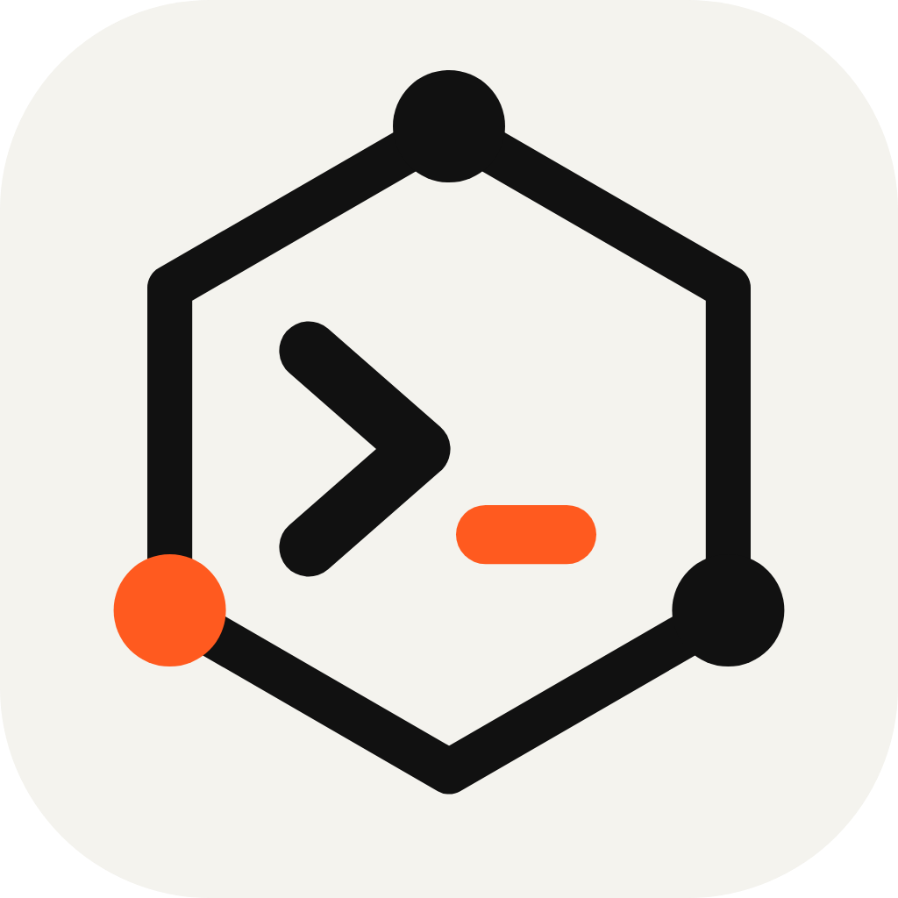
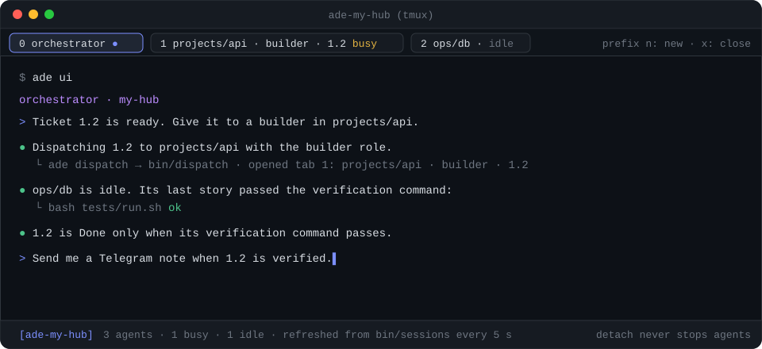
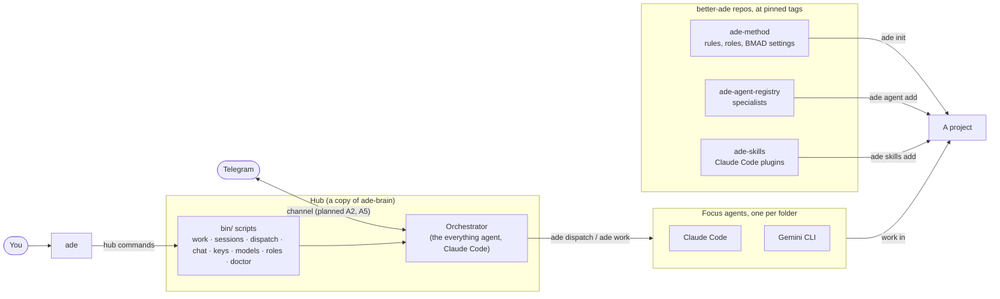
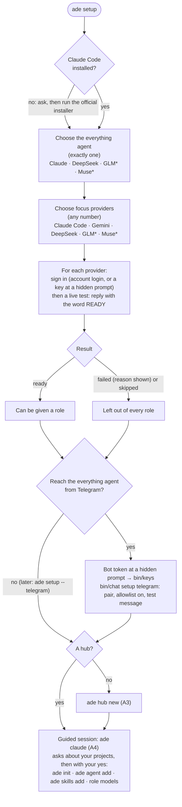

<p align="center">
  
</p>

<h1 align="center">ade</h1>

<p align="center"><strong>One command for ADE in any terminal: your hub, your agents, your method.</strong></p>

<p align="center">
  <a href="https://github.com/better-ade/ade-cli/actions/workflows/ci.yml"></a>
  <a href="https://github.com/better-ade/ade-cli/releases/latest"></a>
  <a href="https://github.com/better-ade/ade-cli"></a>
  
</p>

<p align="center">
  <a href="https://github.com/better-ade/ade-terminal"><strong>ADE app</strong></a> ·
  <a href="https://github.com/better-ade/ade-brain"><strong>ade-brain</strong></a> ·
  <a href="https://github.com/better-ade/ade-method"><strong>ade-method</strong></a> ·
  <a href="https://github.com/better-ade/ade-agent-registry"><strong>ade-agent-registry</strong></a> ·
  <a href="https://github.com/better-ade/ade-skills"><strong>ade-skills</strong></a>
</p>

<p align="center">
  
</p>
<p align="center"><sub>A sketch of <code>ade ui</code> (<a href="docs/stories/A6-ade-ui-tabs.md">A6</a>). Today's commands are in the <a href="#command-reference">command reference</a>.</sub></p>

## What it is

`ade` is a small Bash command that brings ADE to any terminal on macOS or Linux, with or without the ADE desktop app.
Inside a hub (a copy of [ade-brain](https://github.com/better-ade/ade-brain)) it runs the hub's own `bin/` scripts, so
the hub stays the single source of truth and `ade` stays thin. Inside a project it sets up the ADE method, specialist
agents and skills from their own repos, at pinned versions, and never overwrites a file you already have.

> **Status:** version `0.1.0`. Only story [A1](docs/stories/A1-ade-command.md) is built: the hub commands, `init`,
> `agent list|add`, `skills add`, `open`, `version` and `help`. Everything else on this page is marked **planned** with
> the story that will build it.

## Install

**Today** (needs `git` and Bash; `python3` for `ade agent`; Claude Code for `ade skills add`):

```bash
git clone https://github.com/better-ade/ade-cli && cd ade-cli && ./install.sh
```

`install.sh` writes `~/.local/bin/ade` with the version stamped in, and tells you when that folder is not on your
`PATH`. Pass a prefix to install somewhere else: `./install.sh /usr/local`. Re-run it after a `git pull` to upgrade.

Or in one line ([A3](docs/stories/A3-hub-new-and-first-run.md)): the tagged release that main's `VERSION` names, never
main itself (`ADE_CLI_REF=v0.1.0` picks another release).

```bash
curl -fsSL https://raw.githubusercontent.com/better-ade/ade-cli/main/install.sh | bash
```

## Quick start

```bash
ade help                         # every command, one line each
ade version                      # ade 0.1.0

# In a project (any git repo); no hub needed
ade init                         # copy ade-method at its pinned tag; lists what it kept
ade agent list                   # specialists in ade-agent-registry
ade agent add frontend           # copy one into .ade/agents/frontend.md
ade skills add notes             # install an ade-skills plugin for this project (needs Claude Code)

# With a hub
mkdir -p ~/.config/ade && echo ~/hubs/my-hub > ~/.config/ade/hub   # or export ADE_HUB, or run ade inside the hub
ade doctor                       # the hub's bin/doctor
ade status                       # the hub's sessions (bin/sessions)
ade work projects/api --role builder   # start or resume a focus agent (bin/work)
```

`ade hub new my-hub` creates the hub for you ([A3](docs/stories/A3-hub-new-and-first-run.md)); **planned:**
`ade setup` does sign-in, providers, Telegram and a guided first session in one go
([A5](docs/stories/A5-ade-setup.md)).

## How ade fits



`ade` itself holds no state about your work. It finds the hub in this order: `$ADE_HUB`, the nearest folder above the
current one with `bin/lib.sh` and `hub.conf`, then the path in `~/.config/ade/hub`. When the hub lacks a script, `ade`
says "this hub has no bin/&lt;cmd&gt;; update it" and exits 2.

## `ade setup` (planned, A5)

One command from nothing to a working hub and a guided first session. Every step asks first.



<sub>* GLM and Muse stay off until their live check passes. `ade setup --check` reports each step and changes nothing;
`ade setup --test [provider|telegram]` re-runs the live tests.</sub>

## A ticket's path


Nothing is Done because an agent says so. The verification command, agreed in the plan, decides.

## Command reference

| Command | What it does | Status |
|---|---|---|
| `ade work <folder> [--role <r>]` | Start or resume a focus agent (hub `bin/work`) | **built** (A1) |
| `ade status` | List sessions (hub `bin/sessions`) | **built** (A1) |
| `ade dispatch …` | Hand a task to an agent (hub `bin/dispatch`) | **built** (A1) |
| `ade notify …` | Send a notification (hub `bin/notify`) | **built** (A1) |
| `ade chat …` | Chat with the hub (hub `bin/chat`) | **built** (A1) |
| `ade method …` | The hub's method tools (hub `bin/method`) | **built** (A1) |
| `ade keys …` | Manage provider keys (hub `bin/keys`) | **built** (A1) |
| `ade models …` | Show or set models (hub `bin/models`) | **built** (A1) |
| `ade roles …` | Show or set roles (hub `bin/roles`) | **built** (A1) |
| `ade doctor` | Check the hub's health (hub `bin/doctor`) | **built** (A1) |
| `ade sync` | Sync the hub (hub `bin/sync`) | **built** (A1) |
| `ade context …` | The hub's context store (hub `bin/context`) | **built** (A1) |
| `ade agent-run …` | Run an agent (hub `bin/agent`) | **built** (A1) |
| `ade init [--here]` | Copy ade-method at its pinned tag into the project; never overwrites; installs the PR and commit templates and sets `commit.template`; records `.ade/method-version` | **built** (A1) |
| `ade agent list` | Specialists in ade-agent-registry, name and description | **built** (A1) |
| `ade agent add <name> [--here]` | Copy a specialist to `.ade/agents/<name>.md` | **built** (A1) |
| `ade skills add <plugin>` | Add the ade-skills marketplace once, install the plugin at project scope | **built** (A1) |
| `ade open …` | Open in the ADE app (inside the app only) | **built** (A1) |
| `ade version` · `ade help` | The version; every command, one line each | **built** (A1) |
| `ade orchestrator new\|start\|stop\|list\|logs\|remove` | Named orchestrators, one per hub, with their channels (run by the hub's `bin/chat`) | **built** (A2) |
| `curl … \| bash` | One-line install of the tagged release | **built** (A3) |
| `ade hub new <name> [--private\|--public] [--dir <d>] [--no-github]` | Create a hub from the ade-brain template, run its `bin/init`, make it the default | **built** (A3) |
| `ade hub list` · `ade hub use <path>` | The hubs `ade` knows; switch the default | **built** (A3) |
| `ade` (no arguments) | Say what to do next: the hub, its status and the next commands | **built** (A3) |
| `ade claude [<folder>] [-- args]` | Claude Code at the hub root as the orchestrator; with a folder, `ade work <folder>` | **built** (A4) |
| `ade setup [--check\|--test\|--top\|--telegram]` | Sign-in, providers and live tests, Telegram, hub, guided session | **built** (A5; needs the hub pieces in `.ade/context/hub-interface.md`) |
| `ade ui [--detach]` · `ade dash [--once]` | One tmux window, a tab per agent with state icons; fleet sidebar; popups for new agent, approve, tickets, plan preview, help | **built** (A6; needs the hub pieces in `.ade/context/hub-interface.md`) |
| `ade skills list\|enable\|disable\|search` | Skills and plugins on the fly, with a reload hint to running sessions | **built** (A7) |
| `ade clean [--yes]` | Housekeeping: stale locks, old dispatch markers and event cursors, ade's old temp folders, dead `ade-*` tmux sessions, clean merged worktrees (`git worktree remove`); lists first | **built** (A9) |
| `ade reset [--keys] [--hub <path>]` | Undo `ade setup` here: stop orchestrators, remove the chat and monitor services, the `ade@ade-skills` entry and `~/.config/ade/`; `--keys` forgets setup's keys (one question each); `--hub` moves that hub to the Trash | **built** (A9) |
| `ade uninstall [--keys] [--hub <path>]` | `ade reset`, then remove the installed `ade` (never a checkout) and print how to reinstall | **built** (A9) |
| `ade restore [--check] [--label <name>]` | Compare `.ade/connections.json` (names only, committed) with this machine and walk each gap with a yes: the Claude account, keys (hidden prompt, live test), plugins, Telegram (token, re-pair), services | **built** (A10) |
| `ade update [--check \| --rollback \| --auto on\|off]` | ade itself (download, sha256 against the release's `release.json`, checked in a temp folder, the old one kept as `.ade.prev`, one rename; `--rollback` swaps them back), the hub (`git pull --ff-only`, `bin/method sync`), ade-skills plugins, Claude Code, `ade ui` reloaded in place; nothing is stopped; one notify line | **built** (A11) |

Exit codes: `0` success, `1` a failure while working (a fetch or a copy), `2` a usage problem or a missing hub, script
or tool. A hub command exits with whatever the hub's script returns.

### Configuration

| Variable | Default | Used for |
|---|---|---|
| `ADE_HUB` | unset | The hub to use, ahead of walking up and `~/.config/ade/hub` |
| `ADE_METHOD_REF` | `v2.1.0` | The ade-method tag `ade init` copies |
| `ADE_REGISTRY_REF` | `v1.1.0` | The ade-agent-registry tag `ade agent` reads |
| `ADE_METHOD_REPO` | `https://github.com/better-ade/ade-method` | Where ade-method comes from (tests use a local fixture) |
| `ADE_REGISTRY_REPO` | `https://github.com/better-ade/ade-agent-registry` | Where the registry comes from |
| `ADE_HOOK_BIN` | set by the ADE app | What `ade open` hands off to |
| `ADE_NO_UPDATE_CHECK` | unset | `1`: no daily release check (no request) |
| `ADE_NO_AUTO_UPDATE` | unset | `1`: a new ade-cli release is announced, never installed by itself |

## Providers

Everything runs through Claude Code, except Gemini for focus agents, which runs through Gemini CLI. Choosing them is
part of `ade setup` (planned, A5); the hub's `bin/keys`, `bin/models` and `bin/roles` do the work.

| Provider | Runs through | Everything agent (exactly one) | Focus agents (any number) |
|---|---|:---:|:---:|
| Claude (account or Anthropic API key) | Claude Code | yes | yes |
| DeepSeek | Claude Code | yes | yes |
| GLM | Claude Code | yes* | yes* |
| Muse | Claude Code | yes* | yes* |
| Gemini | Gemini CLI | no | yes |

<sub>* after its live check passes. GPT and Codex are not offered.</sub>

## Safety

In plain words:

- **Your keys never sit where other programs can read them.** A key is typed at a hidden prompt and handed straight to
  the hub's `bin/keys` on standard input. It never appears in a command line (where `ps` could show it), in the
  environment of any program, in a log, or in a file in your repo. On macOS it lives in the Keychain. With a Claude
  account, Claude Code's own login is used and `ade` stores nothing.
- **It asks before it changes things.** `ade init` and `ade agent add` never overwrite a file; they list what they kept.
  The planned `ade setup` asks before installing Claude Code, and its guided session asks before each step. New hubs
  are private unless you ask for public (planned, A3).
- **Only you can talk to it on Telegram.** The planned Telegram channel pairs your own Telegram account and switches on
  an allowlist before it sends its first test message (A5, done by the hub's `bin/chat`). The bot token is treated like
  a key.
- **No skipped permissions.** Agents run with Claude Code's normal permission checks. The planned `ade claude` refuses
  `--dangerously-skip-permissions` anywhere in its arguments (A4).
- **Nothing of yours is deleted.** `ade clean` removes only ade's and the hub's own markers, temp folders and dead tmux
  sessions, and worktrees whose branch is merged and that have no changes. `ade reset --hub` never deletes a hub: after
  you type its name, and only when everything in it is committed and pushed, it moves it to the Trash (macOS: Finder or
  `trash`; Linux: `~/.local/share/ade/trash/<hub>-<UTC time>/`) and prints how to put it back.
- **Pinned, not floating.** The method and the registry are copied at fixed tags, so a change upstream reaches your
  projects only when you move the pin.

## The better-ade repos

| Repo | What it is |
|---|---|
| [ade-terminal](https://github.com/better-ade/ade-terminal) | The ADE desktop app: terminals, agents, previews and the verification gate |
| [ade-method](https://github.com/better-ade/ade-method) | The ADE method: rules, core roles and BMAD settings that `ade init` copies |
| [ade-agent-registry](https://github.com/better-ade/ade-agent-registry) | Specialist agents (frontend, backend, devops, …) loaded only when a task needs one |
| [ade-skills](https://github.com/better-ade/ade-skills) | A Claude Code plugin marketplace of skills and MCP servers |
| [ade-brain](https://github.com/better-ade/ade-brain) | The hub template: the orchestrator and its `bin/` scripts |
| [ade-cli](https://github.com/better-ade/ade-cli) | This repo: the `ade` command |
| [ade-website](https://github.com/better-ade/ade-website) | The website, [ade.ardata.tech](https://ade.ardata.tech/) |
| [.github](https://github.com/better-ade/.github) | Shared CI and release workflows that the repos above use |

## Contributing

- **Stories first.** Each change is a story in [`docs/stories/`](docs/stories/) with acceptance criteria and a risk
  level, built test-first.
- **Tests.** `bash tests/run.sh` runs every `tests/test_*.sh`. Tests use local fixture repos and fake tools (`claude`,
  `gh`, hub scripts), never the network, and must pass on macOS Bash 3.2 and on Linux bash.
- **Test layers** ([A8](docs/stories/A8-thorough-testing.md)), each runnable locally:

  | Layer | What | Locally |
  |---|---|---|
  | 1. Shells | the suite on macOS `/bin/bash` 3.2 and Ubuntu bash 5 (it prints the bash it used) | `bash tests/run.sh`; `PATH=/bin:$PATH /bin/bash tests/run.sh` for 3.2 |
  | 2. Lint | shellcheck at warning level over `ade`, `install.sh` and `tests/e2e/`, plus a planted-warning self-test | `bash tests/lint.sh` |
  | 3. Hostile input | every name-taking command against spaces, quotes, `$(…)`, backticks, leading `-`, unicode, newlines, 300 characters; a new command missing from the table fails | `bash tests/test_hostile.sh` |
  | 4. Clean machine | install this checkout, `ade hub new --no-github` from the real template, `ade init`, `agent add`, `skills add`, `status`, `doctor`, `ui` (network) | `bash tests/e2e/clean.sh` |
  | 5. Upgrade | the previous release tag, a hub and a project, then this checkout: nothing lost or overwritten (network) | `bash tests/e2e/upgrade.sh` |
  | 6. Interactive | `ade setup` on a real pty (expect) and in a tmux pane: a typed key never on screen, in `ps` or in a file | `bash tests/e2e/interactive.sh` (needs `expect`, `tmux`) |
  | 7. `ade ui` | real tmux at 120x36 and 80x24: tab bar, sidebar and popups against `tests/golden/ui-*.txt` | `bash tests/e2e/ui_snapshots.sh`; `UPDATE_GOLDEN=1` rewrites |
  | 8. Coverage | traced line coverage of `ade` over the suite (report and JSON as an artifact); fails below `tests/coverage-floor` | `bash tests/coverage.sh` (bash 4.1+) |

- **CI.** Every pull request and every push to `main` runs layer 1 on both systems (job `suite`) through the shared
  [`verify.yml`](https://github.com/better-ade/.github) workflow, and layers 2 and 4-8 as their own jobs
  (`.github/workflows/ci.yml`): `lint`, `e2e-linux` (a fresh `ubuntu:24.04` container), `e2e-macos`, `coverage`. One
  job, `ci`, needs all of them and is the check to require on `main`.
- **Releases.** Bump `VERSION` and add its entry to [`CHANGELOG.md`](CHANGELOG.md) in the same pull request. When the
  change to `VERSION` reaches `main`, the release workflow runs the tests again and publishes the release.
